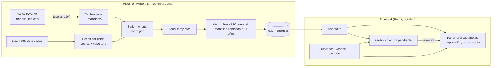

# Implementation Plan: Explorador de tendencias por región (MVP)

**Branch**: `001-trend-explorer-mvp` | **Date**: 2026-11-14 | **Spec**: [spec.md](spec.md)

**Input**: Feature specification from `/specs/001-trend-explorer-mvp/spec.md`

**Note**: Borrador redactado siguiendo la definición de `/speckit-plan` (Spec Kit v1.4.x). Estado: listo para revisión; nada implementado.

## Summary

Un pipeline en Python obtiene de NASA POWER la cuadrícula mensual de MERRA-2, la promedia por estado, calcula la tendencia con el motor ya probado del laboratorio para todas las ventanas de al menos 10 años y escribe archivos JSON estáticos. El frontend React existente se refactoriza para leerlos: buscador y globo para elegir región, selector de variable y periodo, gráfica anual, tarjetas de resultado, explicación y procedencia. Decisiones y evidencia en [research.md](research.md); experiencia de uso en [ux.md](ux.md).

## Technical Context

**Language/Version**: TypeScript 7.0 (frontend) · Python ≥ 3.11 (pipeline; suite verificada con 3.12)

**Primary Dependencies**: React 19.3, Vite 8, react-globe.gl 2.38, three 0.187 · numpy, pandas, scipy, requests · por añadir: `d3-scale`, `d3-shape`, `shapely` (versiones por fijar al instalar)

**Storage**: archivos JSON estáticos en `web/public/data/trends/`; caché de respuestas crudas fuera de git con manifiesto versionado

**Testing**: pytest + pymannkendall (existentes en el laboratorio) · Vitest para el módulo de datos y las plantillas (por añadir) · lista manual de recorrido en `quickstart.md`

**Target Platform**: navegadores actuales con WebGL 2 en escritorio y móvil; modo degradado sin WebGL

**Project Type**: aplicación web estática + pipeline de datos por lotes

**Performance Goals** (objetivos hasta medir, constitución V): 0 cuadros dibujados en reposo; ≤ 400 llamadas de dibujo por cuadro (hoy 2 280 medidas); texturas ≤ 2,5 MB transferidos en móvil (hoy 8,2 MB); cambio de periodo sin espera perceptible porque es una consulta a datos ya cargados

**Constraints**: sin credenciales en el navegador; demo sin red; español; α = 0,05

**Scale/Scope**: 84 regiones × 2 variables × 666 ventanas ≈ 112 000 resultados precalculados; una pantalla principal y una hoja de métodos

## Constitution Check

*GATE: Must pass before Phase 0 research. Re-check after Phase 1 design.*

| Principio | Cumplimiento en el diseño | Estado |
|---|---|---|
| I. Rigor verificable | Un solo motor (Python) produce todos los números; el navegador solo consulta. Estados del análisis en el contrato | Pasa |
| II. Procedencia | Bloque `provenance` obligatorio por serie y manifiesto de descargas | Pasa |
| III. Usable sin 3D | Buscador, tabla y panel operan sin canvas; teclado y tacto en FR-016 | Pasa (por validar con usuarios) |
| IV. Visual al servicio de la lectura | Nubes y rotación se apagan al analizar; panel opaco | Pasa |
| V. Rendimiento y simplicidad | Sin backend ni base de datos; objetivos marcados como tales | Pasa |

Reevaluado tras el diseño: sin violaciones. Abierto: reutilización del código del laboratorio (T001).

## Project Structure

### Documentation (this feature)

```text
specs/001-trend-explorer-mvp/
├── spec.md            # Requisitos e historias
├── plan.md            # Este archivo
├── research.md        # Decisiones, inventario del prototipo, registro de fuentes
├── data-model.md      # Entidades y reglas
├── contracts/data-files.md   # Contrato de los archivos que lee el frontend
├── ux.md              # Revisión del prototipo y propuesta de interfaz
├── quickstart.md      # Qué funciona hoy y cómo se validará
├── tasks.md           # Tareas
├── analysis.md        # Registro del análisis de consistencia
├── checklists/        # requirements.md, science.md, ux.md
└── evidence/          # Capturas y mediciones del prototipo
```

### Source Code (repository root)

```text
pipeline/                      # NUEVO (Python)
├── trendlens/                 # núcleo del laboratorio: config, schema, processing, stats/, explain
├── power_regional.py          # descarga por teselas ≤10°, caché y manifiesto
├── weights.py                 # polígono → pesos por celda
├── build.py                   # series regionales, tabla de ventanas, escritura de JSON
├── manifest/                  # manifiesto de descargas (versionado)
└── tests/                     # pruebas del laboratorio + espaciales + contrato

web/
├── public/data/trends/        # NUEVO: catalog.json, series/, map/
├── public/data/*.geojson      # existente
├── public/textures/           # existente (se añaden versiones ligeras)
└── src/
    ├── App.tsx                # se reemplaza: composición y estado en URL
    ├── components/
    │   ├── EarthGlobe.tsx     # se adapta
    │   ├── RegionSearch.tsx   # nuevo
    │   ├── VariablePicker.tsx # nuevo
    │   ├── PeriodControl.tsx  # nuevo
    │   ├── AnalysisPanel.tsx  # sustituye a RegionPanel.tsx
    │   ├── TrendChart.tsx     # nuevo
    │   ├── ResultCards.tsx    # nuevo
    │   ├── MapLegend.tsx      # nuevo
    │   └── MethodsSheet.tsx   # nuevo
    └── lib/
        ├── geo.ts             # existente
        ├── data.ts            # nuevo: tipos del contrato y carga
        ├── explain.ts         # nuevo: plantillas en español
        └── urlState.ts        # nuevo
```

**Structure Decision**: aplicación web existente en `web/` más un paquete de lotes `pipeline/` en la raíz. `practice-lab/` no se toca; su código se trae desde `practice/trendlens-lab` (T002).

## Reparto por especificación

Cada persona lleva una especificación con rutas propias; ver el índice en [tasks.md](tasks.md). La estructura de `web/src/` cambia respecto al árbol anterior: `app/`, `lib/`, `styles/`, `content/` y una carpeta por funcionalidad en `features/` (`query`, `globe`, `analysis`, `guide`). Las interfaces que las unen están en [../002-foundation/spec.md](../002-foundation/spec.md). Este documento sigue siendo la fuente de las decisiones comunes.

## Arquitectura



- **Dónde se obtienen los datos**: en el pipeline, antes de la demo. El navegador nunca llama a NASA.
- **Dónde se calcula**: en el pipeline. El navegador elige la fila de la ventana pedida; no hace estadística.
- **Transición**: (1) contrato y un archivo de ejemplo desbloquean el frontend; (2) el pipeline sustituye el ejemplo por datos reales; (3) se retira `RegionPanel.tsx`.
- **Evolución**: el mismo contrato puede servirlo un servicio (regiones libres, AppEEARS, IMERG) sin cambiar el frontend.

## Método de principio a fin

1. Descargar la cuadrícula mensual por teselas; guardar respuesta, URL, fecha y huella.
2. Validar unidad declarada, relleno −999 → faltante, descartar la clave anual `13`, rango físico.
3. Pesos por celda y serie mensual regional; un mes regional es válido solo si todas sus celdas lo son.
4. Precipitación: tasa × días del mes → mm/mes. Año completo = 12 meses válidos; los incompletos se excluyen y se listan, sin interpolar.
5. Para cada ventana: Sen, intervalo, MK original y corregido, r₁, MCO ajustado, estado.
6. Estado: `insufficient` si n < 10; `increasing` / `decreasing` si p corregido < 0,05 según el signo; `inconclusive` en otro caso; `invalid` si la serie es constante o falla una validación.
7. Diagnósticos del periodo completo: escalón frente a recta, años excluidos, autocorrelación significativa.

## Validación científica

| Prueba | Qué demuestra | Origen |
|---|---|---|
| Tendencia conocida, sin tendencia, estacionalidad pura, constante, huecos, n insuficiente | Comportamiento del motor en casos límite | Suite del laboratorio (existente) |
| Autocorrelación: tasa de falsos positivos | Límites de la corrección | Suite del laboratorio |
| Referencia independiente: `pymannkendall`, `scipy.stats.theilslopes`, valores a mano | No se compara el código consigo mismo | Suite del laboratorio |
| Pesos: celda única, polígono que cubre una celda entera, suma de fracciones = área, región pequeña | Promedio espacial correcto | Nueva |
| Serie real: una región de una sola celda frente al endpoint por punto; valor anual frente a la clave `13` (tolerancia 0,01 por redondeo) | El pipeline no altera los datos | Nueva |
| Serie real externa: un estado de EE. UU. frente a Giovanni (misma variable de MERRA-2, forma del estado), tolerancia 0,1 °C en medias anuales | Promedio regional coherente con una herramienta oficial | Nueva; requiere cuenta Earthdata **[P]** |
| Contrato: cada archivo cumple el esquema y toda fila tiene estado | El frontend no recibe huecos | Nueva |

## Hoja de ruta

| Etapa | Contenido |
|---|---|
| **MVP (este incremento)** | US1 a US4 (equipo de cuatro o más); US3 y US4 son lo primero que se recorta |
| Siguiente | Comparación de dos regiones y exportación (US5); marcas de evidencia con control de falsos descubrimientos; detectabilidad como escenario |
| Después | Segunda fuente con observaciones (AppEEARS: NDVI, temperatura de superficie; IMERG); servicio para regiones libres; mapa 2D si las pruebas lo piden; más países |

## Riesgos

| Riesgo | Mitigación | Señal para activar la alternativa | Efecto en el alcance |
|---|---|---|---|
| El endpoint regional de POWER falla o limita | Caché desde la primera descarga; endpoint por punto | Dos teselas seguidas con error o > 30 s | Menos regiones: solo las de demostración |
| Reglas que impiden reutilizar el laboratorio | T001 antes de T002 | Respuesta negativa | +8–10 h: se reimplementa solo Sen + MK corregido |
| Geometrías: regiones pequeñas, islas, Alaska cruza 180° | Reglas de región pequeña; prueba de pesos | Alguna región sin celdas | Esa región queda «sin datos» |
| Rendimiento del globo en móvil | T023; mediciones T030 | Objetivo incumplido en el teléfono de referencia | Globo estático o sin fondo de países en móvil |
| Dificultad de uso | Buscador como camino principal; prueba T029 | < 3 de 5 completan una tarea | Rehacer el control afectado antes de añadir funciones |
| Conclusiones engañosas | Estados y plantillas probados; avisos de periodo y de mapa | Una persona interpreta causa o «no hay cambio» | Reescribir el texto; nunca ocultar el aviso |
| Precipitación de reanálisis poco fiable para tendencias | Se declara en la definición | Revisión de un mentor | Dejar solo temperatura |
| Tiempo de cómputo y tamaño de archivos | Medir en T007 | > 15 min o > 20 MB | Ventanas con año final fijo |
| Sin red en la demo | Todo es estático y local | — | Ninguno |
| Servicios de GES DISC en migración | No se depende de ellos | — | Solo afecta a la validación con Giovanni |

## Complexity Tracking

Sin violaciones de la constitución que justificar.
